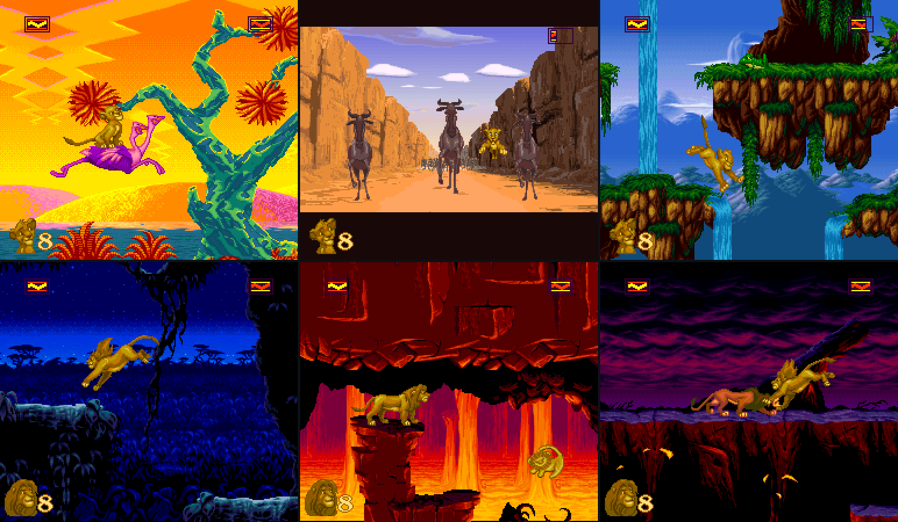
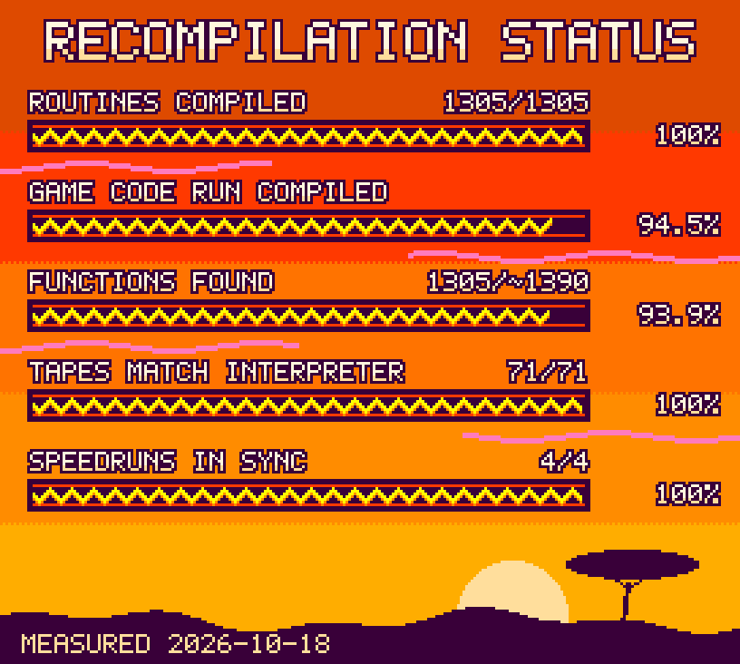
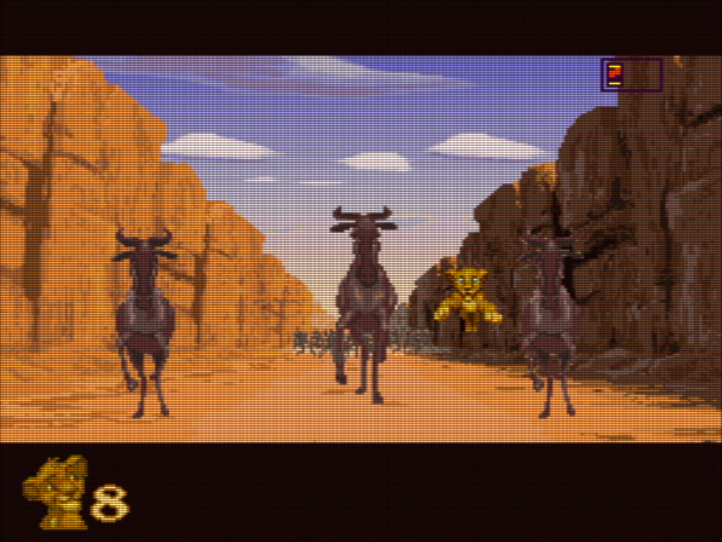

# TLKRecomp

**Disney's *The Lion King* (SNES, 1994), running as a native PC program.**

TLKRecomp is a static recompilation of the US release, built with
[snesrecomp](https://github.com/RetroPortingToolKit/snesrecomp). The game's 65816 program is translated to C and
compiled for your CPU; graphics, sound and timing run on snesrecomp's emulated PPU and SPC, so it plays like the
cartridge, from the Westwood logo to the last hit on Scar. It runs on Linux and Windows.

**No game data is in this repository.** No ROM, no assets, no generated code. Bring your own dump
(`Lion King, The (USA).sfc`, 3 MiB headerless, SHA-256 `457abe63...0f3712`); the build reads it and generates the C
on your machine.

## Status

- **Routines compiled**: every entry point the recompiler knows about has a compiled C body.
- **Game code run compiled**: share of the instructions on a whole-game run (All Bugs, idle loops excluded) that
  run as compiled C. The rest still runs in snesrecomp's interpreter: a few routines the game enters in a CPU mode
  the compiler can't handle yet.
- **Functions found**: entry points known to the recompiler, out of about 1,390 known to exist. The real total is
  probably 1,450-1,550; the rest are reached only through pointers (`docs/function_count.md`).
- **Tapes match interpreter**: 71 hand-made input tapes give the same frame and RAM compiled and interpreted.
- **Speedruns in sync**: three TASVideos runs and All Bugs, game RAM checked against BizHawk (bsnes).

The card is drawn by `tools/status_card.py`, in the colours of the game's HUD; each number in it names the command
that measured it.

## Features

- **The whole game**, start to finish, bonus stages included, on keyboard or gamepad.
- **Checked against real emulation.** Game RAM stays in sync with BizHawk (bsnes core) through three published
  speedruns and a 60,648-frame All Bugs run. Compiled and interpreted code give identical frames and RAM on 71
  hand-made input tapes.
- **Settings menu in the game.** Tab or Esc opens it. Every change applies immediately and is saved.
- **Shaders and scaling.** CRT, LCD grid, Sharpen and Composite presets; 8:7, 4:3 or 1:1 aspect; integer scaling;
  fullscreen.
- **Practice mode** for speedrunners: level timer, TAS target, splits, lag counter, input display, best times,
  one-key level restart.
- **Level select** with the debug menu's invulnerability (infinite health or infinite lives).
- **Save states** in four slots, and a **turbo** key that runs the game up to 16x.
- **Remappable controls**: any key or gamepad button; pads can be plugged in mid-game.
- **Speedruns included.** Four tool-assisted runs from TASVideos play back in sync to the end.

<table>
  <tr>
    <td width="33%"></td>
    <td width="33%"></td>
    <td width="33%"></td>
  </tr>
  <tr>
    <td align="center">Settings menu</td>
    <td align="center">Practice mode</td>
    <td align="center">CRT shader, 4:3</td>
  </tr>
</table>

## Quick start

Linux needs cmake, ninja, gcc or clang, Python 3 and SDL3:

    git clone --recursive https://github.com/kinduff/TLKRecomp
    cd TLKRecomp
    cp "/path/to/Lion King, The (USA).sfc" .     # the build and the player find it here
    ./build.sh
    build/tlk_sdl

A cold build takes about 7 minutes on 12 threads. `ccache` is used when installed, so later rebuilds are much faster
(`-DTLK_USE_CCACHE=OFF` turns it off). `cmake --build build --target tlk_sdl` builds only the player.

Without `--rom` (and no `rom =` in the ini), `tlk_sdl` looks for the right ROM next to the binary and in the current
directory. If it finds none, it opens a file dialog, checks the file you pick, and remembers it.

Options: `--scale N` (window size, default 3), `--fullscreen`, `--no-audio`, `--config file.ini`.

## Controls

| SNES | Key |
|---|---|
| D-pad | arrow keys |
| B / A | Z / X |
| Y / X | A / S |
| L / R | Q / W |
| Start / Select | Enter / Right Shift |

Everything else:

| Key | Does |
|---|---|
| Tab or Esc | settings menu (the game pauses). In the menu, Esc goes back and closes; Tab resumes |
| F1-F4 | save state to slot 1-4 |
| F5-F8 (or Shift+F1-F4) | load slot 1-4 |
| ` (hold) | turbo: the game runs `turbo_speed` times faster (4 by default), sound muted. Pad: right stick click |
| F9 | practice mode: restart the current level |
| F11 or Alt+Enter | fullscreen |

**Gamepads** work out of the box, by button position: bottom = B, right = A, left = Y, top = X; shoulders and
triggers = L/R; left stick or d-pad moves. Guide, or Back+Start, opens the menu; in it the d-pad moves, A selects,
B goes back, Start closes.

Save states are `tlk_slot1.state` .. `tlk_slot4.state`, in the same folder as the ini. They only load in the build
that wrote them.

## The settings menu

The menu is [recomp-ui](https://github.com/RetroPortingToolKit/recomp-ui)'s in-game menu, the same one other recomps
use, drawn with Dear ImGui over the game. Up/Down pick a section, Enter opens it, Left/Right change a value, Esc goes
back.

| Section | What's in it |
|---|---|
| Display | window scale, fullscreen, vsync, aspect, how much the menu dims the game |
| Graphics | shader, smooth and integer scaling, HD Mode 7 |
| Audio | sound on/off, volume |
| Level select | level, invulnerability, start |
| Practice | practice mode on/off |
| Controls | pick a SNES button, press Enter (or pad A), then the new key *or* pad button. Esc or Guide cancels; "Reset defaults" restores the tables above |
| System | Resume, Quit (press twice) |

Every change is saved to `tlk_sdl.ini` (the file is rewritten, so comments are dropped). Without OpenGL 3.3 the menu
is drawn small inside the game picture.

**Video.** The picture goes through snesrecomp's OpenGL 3.3 presenter. The Shader row cycles the bundled presets
(CRT, LCD grid, Sharpen, Composite; CC0, from snesrecomp's `runner/assets/shaders`), which the build copies to
`build/assets/shaders` and the release packages ship next to the binary. Aspect, Smooth and Integer scaling work
with or without a shader. Without OpenGL 3.3 (or with `opengl = 0`) the game runs on the plain SDL renderer and the
Shader row is greyed out. None of this changes the emulated picture: hashes, `--dump-png` and the gates read the PPU
frame.

**HD Mode 7** (off, 2x, 3x, 4x) is snesrecomp's opt-in renderer (`docs/HD_MODE7.md` in the submodule). It draws Mode
7 lines at that multiple of the native resolution. The Lion King never uses Mode 7 (no Mode 7 line on any speedrun or
play tape), so here the picture is the same with it on; it costs CPU time and hands a shader a 2-4x larger picture.

### The settings file

Settings go in `tlk_sdl.ini` in the working directory (or the file in `$TLK_SDL_INI`):

    rom = /path/to/Lion King, The (USA).sfc
    scale = 4
    fullscreen = 0
    vsync = 0          ; 0 = exact 60.0988 Hz timer, 1 = follow the monitor
    audio = 1
    audio_rate = 48000
    volume = 100       ; percent
    shader =           ; empty, assets/shaders/crt-soft.glslp (or lcd-grid, sharp, warm-composite), or your own
    aspect = 8:7       ; 8:7 square pixels, 4:3 as a TV showed it, 1:1
    smooth = 0         ; 1 = bilinear scaling (with no shader)
    integer_scale = 0  ; 1 = whole-number scaling only (black borders, even pixels)
    opengl = 1         ; 0 = plain SDL renderer, no shaders
    hd_mode7 = 0       ; 2, 3 or 4 = Mode 7 drawn at that multiple (0 = off)
    turbo_speed = 4    ; 2-16, how much faster the game runs while turbo is held
    speedrun = off     ; or practice
    ; keys use SDL key names
    turbo = `
    b = Z
    a = X
    start = Return
    select = Right Shift
    ; gamepad buttons use SDL names (a = bottom, b = right, x = left, y = top)
    pad_b = a
    pad_y = x
    pad_start = start
    pad_turbo = rightstick

## Practice mode

"Practice" in the settings menu (or `speedrun = practice` in the ini) is for learning a route, like SBDWolf's
practice hack. It only reads the game's memory, so the game plays exactly the same with it on or off.

- **Level timer** at the top: starts when the level fades in, stops at the level's end (green) or on a death (red,
  with an `x`). It pauses during fades and the pause screen, like the practice hack's timer.
- **TAS** next to it: the same level's time in the 6987M tool-assisted speedrun, as a target.
- **RUN** under it: everything since leaving the title screen, fades, loads and pauses included; stops at the last
  hit on Scar. A `*` means it is not a clean run (started past level 1, or a save state was loaded).
- **Lag counter**: frames in this attempt where the game did not read the pad.
- **Checkpoint splits**: reaching a checkpoint shows the level time so far and the difference to your best at that
  checkpoint (or to the TAS the first time).
- **Input display** at the bottom right: the buttons sent to the game this frame.
- **Best times** per level and difficulty, in `tlk_practice_times.txt` next to the ini. Only a run that entered the
  level from its start counts (not after a death or a loaded save state). A level end shows the time and the
  difference to your best.
- **F9** restarts the level: it loads a save state taken automatically when the level finished loading
  (`tlk_practice_restart.state`).

## Level select

The menu's Level select section works with practice mode on or off. Pick a **Level** and **Invulnerable** (Off,
Infinite health, Infinite lives) with Left/Right; nothing happens until you press Enter (or pad A) on the third row,
**Start <level>**. It goes back to power-on and plays the game's own debug menu (Options, B A R R Y) in about two
seconds, so difficulty and options are the defaults. Invulnerable is that debug menu's INVUL option: infinite health
refills health every frame, infinite lives puts the count back to 3 before each death.

## Watching a speedrun

`tapes/` holds four tool-assisted speedruns (TAS) as input tapes, replayed in sync to the end:

    build/tlk_sdl --rom "/path/to/Lion King, The (USA).sfc" --input-polled tapes/allbugsF.read.tape

| Tape | Run |
|---|---|
| `6987M.read.tape` | [TASVideos #6987](https://tasvideos.org/6987M), any% in 10:50.396 by EZGames69, SBDWolf, Akiteru & ShgofcTAS |
| `6781M.read.tape` | [TASVideos #6781](https://tasvideos.org/6781M), any% in 10:53.424 by EZGames69, SBDWolf & Akiteru |
| `4735M.read.tape` | [TASVideos #4735](https://tasvideos.org/4735M), any% in 11:22.99 by EZGames69 & SBDWolf |
| `allbugsF.read.tape` | [Lion King All Bugs Final WIP](https://tasvideos.org/UserFiles/Info/639031773616833383) by ShgofcTAS, whole game with bonus stages |

Use `--input-polled`, not `--input`: these tapes hold one pad value per game pad read, not one per frame, and
played with `--input` they desync at once. `--no-pace` fast-forwards. They were converted from the authors' BizHawk
movies (`tools/bk2_to_tape.py`, `docs/VERIFYING.md`): the button presses, re-timed to the game's pad reads. The
movies are published on TASVideos under [CC BY 2.0](https://creativecommons.org/licenses/by/2.0/), and so are these
tapes; credit the authors above when you reuse them.

## Windows and packages

Windows x86_64 is cross-built on Linux with MinGW-w64 (`x86_64-w64-mingw32-gcc`). SDL3 (pinned, fetched) and the
MinGW runtime are linked statically, so the `.exe` files need only system DLLs:

    python3 scripts/generate_snesrecomp.py   # if generated/ is empty
    cmake -S . -B build-win -G Ninja -DCMAKE_BUILD_TYPE=Release \
          -DCMAKE_TOOLCHAIN_FILE=cmake/mingw-w64-x86_64.cmake -DTLK_STATIC_SDL=ON
    cmake --build build-win --target tlk_headless tlk_sdl

`build-win/tlk_headless.exe` and `tlk_sdl.exe` run under Wine with the same arguments as the Linux builds
(`docs/VERIFYING.md`); real Windows has not been tested yet.

`scripts/package.sh` builds `dist/TLKRecomp-linux-x86_64.tar.gz` (binary, README and license notes; no ROM and no game
data) and `scripts/package_appimage.sh` the same program as `TLKRecomp-linux-x86_64.AppImage` (settings, saves and a
ROM go next to the .AppImage file). `scripts/package_win.sh` builds `dist/TLKRecomp-windows-x86_64.zip` from
`build-win/`, and the same `tlk_sdl.exe` alone as `TLKRecomp-windows-x86_64.exe`: the shader presets and menu font are
compiled into `tlk_sdl` and, when no `assets/` folder sits next to it, unpacked to the per-user folder
(`%APPDATA%\TLKRecomp`). `cmake --install build --prefix DIR` installs `bin/tlk_sdl` and the same notes.

`scripts/package_mac.sh` builds `dist/TLKRecomp-macos-arm64.dmg` (TLKRecomp.app) and a `.zip` with the bare binary on
a Mac (Xcode command line tools, cmake, ninja, Python 3, Rust for the generator). Started from Finder the app runs in
`/`, so `tlk_sdl` keeps its ini and saves in `~/Library/Application Support/TLKRecomp` (any time the current directory
is not writable). It has been built and run on one Apple Silicon MacBook; it is not notarized and has not been run
through the comparison gates. The icon is original art (`tools/make_icon.py`).

`scripts/release.sh -r ROM` builds the Linux and Windows packages and writes `dist/SHA256SUMS`. Before packing, it
compares compiled mode with `--lle` on each build (Windows under Wine) at attract-mode frames 600 and 3000 and at
frame 6000 of the 6987M tape, and checks that Linux and Windows give the same hashes; after packing, the AppImage and
the single .exe must show the same frame 600. Pushing a `v*` tag runs it in CI (`.gitea/workflows/release.yml`),
builds the macOS packages on a Mac runner, and publishes everything as one release. These checks are a quick subset:
run the full gates in `docs/VERIFYING.md` before tagging.

## How it works

The ROM's code is found and translated to C ahead of time, then compiled like any other program: 1,305 of 1,305
known routines are compiled. About 5.5% of the instructions on a whole-game run (idle loops excluded) still run in
snesrecomp's interpreter, for code the game enters in a CPU mode the compiler can't handle yet. The interpreter (`--lle`) is also the
reference: the compiled build must produce the same frames and RAM as it for the same input. `docs/HOW_IT_WORKS.md`
explains the pipeline, and `docs/devlog.md` has every fix with its evidence.

`build/tlk_headless` is the windowless test host; `tlk_sdl` runs the same emulation path. With tapes in place
(`tools/make_play_tapes.py`, `tools/bk2_to_tape.py`), `scripts/compare_modes.sh`, `scripts/check_all_tapes.sh` and
`scripts/check_allbugs.sh` compare compiled code against the interpreter. Full list: `docs/VERIFYING.md`.

| Path | What |
|---|---|
| `recomp/` | per-bank function lists and hints that drive the recompiler |
| `runner/` | game glue, SDL desktop host (`tlk_sdl`), headless test host (`tlk_headless`) |
| `patches/snesrecomp/` | code generator patches, applied to a copy of the submodule at generate time |
| `cmake/runtime-patches/` | runtime patches, applied the same way |
| `scripts/` | generate, build, package, and the verification gates |
| `tapes/` | speedrun input tapes (see above) |
| `tools/` | tape conversion, BizHawk Lua loggers, coverage and accounting |
| `docs/` | `HOW_IT_WORKS.md`, `VERIFYING.md`, `devlog.md` (engineering diary), function count |

The `snesrecomp` submodule is never edited in place.

## Credits

- [snesrecomp](https://github.com/RetroPortingToolKit/snesrecomp) (RetroPortingToolKit); project layout follows
  [DKC3Recomp](https://github.com/elliotttate/DKC3Recomp).
- Reference runs: TASVideos movies #6987 (EZGames69, SBDWolf, Akiteru, ShgofcTAS), #6781 (EZGames69, SBDWolf, Akiteru),
  #4735 (EZGames69, SBDWolf), #2716 (Tompa), and ShgofcTAS's All Bugs run.
- Practice mode follows SBDWolf's Lion King practice hack.
- Prototype and unused-content research: The Cutting Room Floor, Hidden Palace.

## Legal

The Lion King is (c) Disney / Virgin Interactive. This project is not affiliated with or endorsed by them. The
screenshots in `docs/img/` are of the game running in this port and are shown to document it.
This repository's own code is MIT (`LICENSE`); the speedrun tapes in `tapes/` are CC BY 2.0 (see above). snesrecomp
is under the PolyForm Noncommercial License 1.0.0, so builds of this project may not be sold or used commercially.
Release binaries contain the game's program code translated to native code and do nothing without your own ROM.
